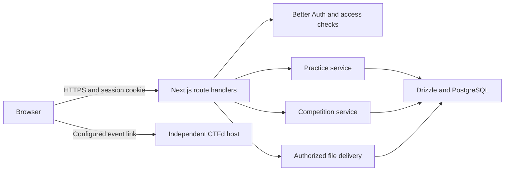

# dfCTF architecture

dfCTF is a modular monolith: one Next.js application and PostgreSQL, deployed as Vercel Node.js functions or a persistent Node.js server. PostgreSQL stores private artifact contents alongside their metadata; persistent hosts can also keep local backup copies. Better Auth owns authentication. Practice and competitions share reviewed challenge content and file delivery, with separate solve records and scoring.



## Boundaries

| Boundary | Responsibility |
| --- | --- |
| Browser | Displays server responses and submits requests. Holds no database credential, validator digest, or staff authority |
| HTTP handlers | Bound request bodies, verify origins, validate input, resolve the authenticated user, and enforce access or staff MFA |
| Authentication | Better Auth manages credentials, sessions, verification, reset tokens, and second factors. Access checks re-read current roles, email verification, suspensions, and staff grants |
| Practice service | Lists practice-only content, validates flags, writes one eligible practice award per challenge family, and unlocks walkthroughs |
| Competition service | Manages events, registration, timing, exclusive challenge assignments, fixed point values, event solves, and event standings |
| File delivery | Rechecks authorization and event access, reads private storage, and serves an attachment. The server does not extract or execute artifacts |
| Database | Foreign keys, unique indexes, transactions, row locks, and server-owned tables preserve state invariants |
| CTFd | An HTTPS link to an existing event. That host owns its accounts, challenges, hint policy, and scoring |

## Challenge lifecycle

`draft → review → published → archived`

An author chooses Practice library or Competition only while drafting. An independent reviewer or administrator can correct content, flags, files, and availability while the challenge is In review; saving preserves that status. Publication requires a different reviewer from the original author and a correct test-solve flag after saving edits. Published content, flags, files, and availability stay locked. Authors return their own review to draft before making corrections.

Practice APIs reject competition-only content, including direct detail, submission, and download requests. Public practice statistics exclude it. A competition-only challenge belongs to one event, so an already exposed answer cannot be reused for a new event through the hosting form.

## Competition lifecycle

`draft → published → archived`

Published event settings are immutable: participants compete against the same schedule, lineup, and fixed points. A host may archive an event to withdraw it. A linked challenge cannot be archived while its published event is still pending or running.

| Phase | Registration | Challenge details and files | New scores |
| --- | --- | --- | --- |
| Before start | Open | Hidden from players | Rejected |
| Start inclusive to end exclusive | Open | Registered players | Registered players |
| End and later | Closed | Existing registered players may review | Rejected |
| Draft or archived | Closed | Staff authoring/management only | Rejected |

The server checks timing and registration on each protected request. Browser timers do not grant access. Schedule inputs use Asia/Manila explicitly; persisted dates are timezone-aware timestamps.

## Scoring and concurrency

Practice uses `submissions`, `solves`, and `xp_ledger`. Competitions use `competition_submissions` and `competition_solves`; event points never enter the practice ledger.

Correct submissions run in a database transaction. A per-user row lock serializes simultaneous attempts, and database uniqueness permits one solve per player and event challenge. Publication and challenge state are rechecked under locks. A repeated correct flag returns `already_solved` and awards nothing. Guesses consume a persistent rate budget outside the scoring transaction, including when validation later fails.

First blood uses the earliest stored solve ordered by timestamp and ID, selecting one winner on timestamp ties. Standings use points descending, then the time the player reached that score. Only public codenames, solve times, and scores reach other players.

## Database access and Supabase

Supabase is an optional PostgreSQL host. This application does not use Supabase Auth or its browser Data API. Database credentials remain server-side; browser traffic goes through the Next.js handlers.

Every application table enables row-level security without browser-facing policies. Untrusted database roles receive no rows and cannot insert through ordinary table access. The backend uses the application table owner connection, which PostgreSQL normally exempts from row policies; application permissions are enforced in server code. [PostgreSQL row security](https://www.postgresql.org/docs/current/ddl-rowsecurity.html).

Supabase's Data API can also be disabled when using only Drizzle. [Supabase's Drizzle guide](https://supabase.com/docs/guides/database/drizzle). Do not introduce a browser database SDK or permissive policies to bypass the application routes.

## Schema changes and deployment

The TypeScript schema and committed `drizzle/` migrations are the source of truth. Generate a migration when the schema changes, review its diff, test it, then apply it from the configured deployment environment:

```powershell
npm run db:generate
npm run db:migrate
```

`db:migrate` applies pending versions and closes its connection even on failure. It uses `DATABASE_MIGRATION_URL` when configured, otherwise `DATABASE_URL`. It does not require email or OAuth configuration. No Supabase SQL Editor step is required.

Apply migrations once before starting a replacement app. The Docker deployment procedure is in [DEPLOYMENT.md](DEPLOYMENT.md). For Supabase, prefer its direct connection for migrations, or session mode on an IPv4-only network; obtain the exact URL from its Connect dialog. [Supabase connection modes](https://supabase.com/docs/guides/database/connecting-to-postgres).

Local development may use embedded PGlite with one application process. Production uses PostgreSQL for records and artifact contents. Persistent hosts also keep local copies by default; Vercel and hosts with `ARTIFACT_LOCAL_BACKUP=0` use database-only storage. Legacy file-only records must be backfilled with `npm run db:backfill-artifacts` before disk fallback is disabled. CI tests the application with PGlite and runs the competition, concurrency, and table-access suite again against a disposable PostgreSQL service. Browser tests exercise the production-rendered UI with controlled API fixtures. External email, OAuth, remote database connectivity, and backup restoration still require deployment checks.
